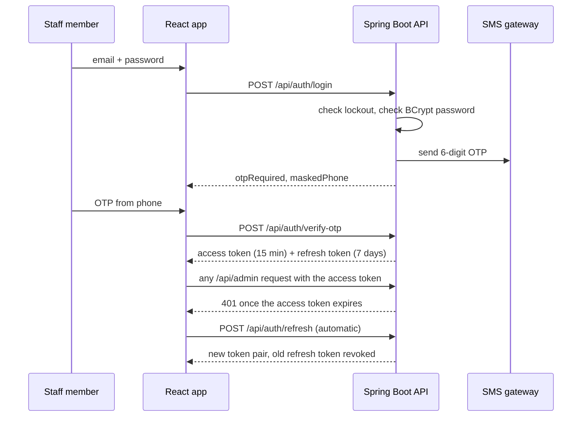

# Architecture

```
Browser (React + TypeScript)  --/api-->  Spring Boot (controller > service > repository)  -->  MySQL
        :5173 (Vite)                              :8080                                       :3306 (Docker)
```

## Repository layout

```
parlour/
├── backend/                     Spring Boot API (Maven)
│   └── src/main/java/com/parlour/api/
│       ├── controller/          HTTP layer only: read the request, call a service, return a DTO
│       │   └── admin/           endpoints for logged-in staff
│       ├── service/             business rules (booking slots, OTP, tokens, file storage)
│       ├── repository/          database access (Spring Data JPA interfaces)
│       ├── entity/              JPA entities = database tables (the ORM mapping)
│       ├── dto/                 request/response shapes, one record per file, grouped by feature
│       ├── config/              security, CORS, static files, demo data seeding
│       └── exception/           ApiException + one global error handler
├── frontend/                    React + TypeScript (Vite)
│   └── src/
│       ├── api/                 every HTTP call (api.ts) and the fetch wrapper with token refresh (client.ts)
│       ├── auth/                login state, route guard
│       ├── components/          reusable UI parts (calendar, slot picker, navbar ...)
│       ├── hooks/               shared React hooks
│       ├── pages/               one file per screen; pages/admin/ holds the dashboard tabs
│       ├── styles/              CSS split by concern (base, buttons, navbar, home, forms, booking, admin ...)
│       ├── types/               TypeScript interfaces, grouped by feature (no `any` anywhere)
│       └── utils/               pure helper functions (formatting, validation)
├── docs/                        API.md, ARCHITECTURE.md
├── .github/                     CI workflow and pull request template
├── docker-compose.yml           MySQL (default) and the full stack (`--profile full`)
└── start.ps1                    one-command local start for Windows
```

Rule of thumb: **a layer only talks to the layer below it.** Controllers call services (never repositories); services hold the business rules and are the only ones that call repositories.

## Why the main pieces exist

| Concept | Where | Why |
|---|---|---|
| ORM / JPA / Hibernate | `entity/`, `repository/` | We write Java objects, Hibernate creates tables and SQL |
| Access token (JWT, 15 min) | `service/JwtService`, `config/JwtAuthFilter` | Stateless proof of who is calling and with which role |
| Refresh token (7 days) | `service/AuthService`, `entity/RefreshToken` | Gets a new access token without logging in again. Rotates on every use; reuse of an old token revokes the session |
| OTP | `service/OtpService`, `service/SmsSender` | Second factor for staff login and phone proof for customers. Hashed, expires, max 3 tries, single use |
| Login lockout | `service/LoginThrottle` | 5 wrong passwords lock an email for 15 minutes |
| Roles | `config/SecurityConfig` | One place that lists which role may call which URL |
| Dynamic page | `frontend/src/pages/Home.tsx` | Services and site texts come from the database, the owner edits them in the dashboard |
| Docker / container | `docker-compose.yml`, `*/Dockerfile` | MySQL (and optionally the whole app) runs without installing anything |

## Staff login sequence



## Known limits (honest list)

- Login lockout and booking synchronisation are in memory, which is correct for one server. With several servers, move them to Redis or the database.
- Schema is created by Hibernate (`ddl-auto=update`). For production use a migration tool such as Flyway.
- SMS is printed to the console in development. A real gateway needs one class implementing `SmsSender`.
